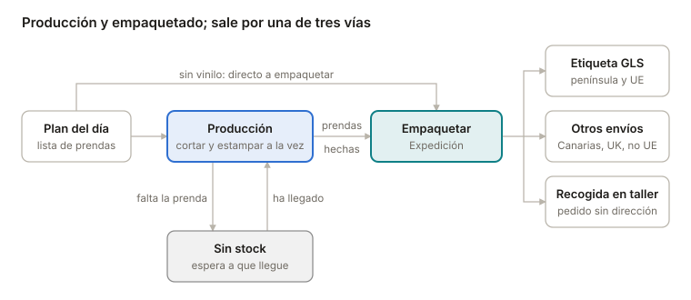

# Manual de uso · Programa de taller de Singular Wardrobe

Este programa organiza todos los pedidos de la tienda online desde que entran hasta que salen del taller. Se abre en el navegador en [tallersingular.netlify.app](https://tallersingular.netlify.app) y lo usamos todas a la vez, desde un ordenador compartido o una tablet.

## 1. Antes de empezar

Cada mañana a las 8:00 el programa trae los pedidos nuevos de la tienda y recoge los cambios de los que ya tenía (por ejemplo, una talla cambiada). No hace falta hacer nada para que aparezcan.

**Entrar**

1. Abre Chrome y entra en tallersingular.netlify.app.
2. Escribe el email y la contraseña del taller y pulsa Entrar.
3. Si el ordenador se queda encendido, la sesión sigue abierta al día siguiente.

**¿No recuerdas la contraseña?** Pídele a Tito que te ponga una nueva desde 👥. También puedes escribir tu email en la pantalla de entrada y pulsar **¿Has olvidado la contraseña?**: te llega un correo con un enlace (mira también en correo no deseado) y, al abrirlo, el programa te pide la contraseña nueva dos veces. El enlace solo vale una vez y caduca al cabo de un rato.

**Dar de alta a una persona (solo el administrador)**

El botón **👥** de arriba solo le sale al administrador. Sirve para dar de alta a cada persona y ponerle contraseña, sin correos.

1. Pulsa **👥**. Sale la lista de usuarios con su último acceso.
2. En **Añadir persona** escribe su nombre y un email que hará de nombre de usuario. No hace falta que exista: por ejemplo dania@singularwardrobe.com.
3. Escribe una contraseña o pulsa **Generar** (sale una fácil de dictar, como «Coral-4821-mar»), elige su **puesto** y pulsa **Añadir**.
4. Dile a esa persona su email y su contraseña. Después puede cambiarla ella con 🔑.

Si alguien olvida la contraseña, en su fila pulsa **🔑 Poner contraseña**. Para cambiarle el puesto, márcalo en su fila: lo verá al recargar la página. En las personas de Expedición sale además la casilla **⭐ Responsable de Expedición**: quien la tenga marcada puede pausar y reanudar el reparto y recuperar pedidos de sus compañeras (apartado 6). Hoy es Dania. Para que alguien deje de entrar, pulsa **Quitar acceso** dos veces.

**Tu pantalla según tu puesto**

| Puesto | Qué ve |
| --- | --- |
| Administración | Al entrar, la pantalla de **Gerencia** (Dashboard y Mi día, apartado 17). Con el botón **Ver todo el programa** pasa al programa entero: Plan del día, Pedidos, Resumen producción, Histórico y Ayuda. El botón **Gerencia** de arriba vuelve al dashboard. |
| Producción | **Por hacer**: las prendas que hay que cortar y estampar, por color de vinilo y de la A a la Z, con ✔ Hechas, Todas y ✖ No hay. **Prendas sin vinilo**: los productos que no se cortan (como «cupido»), con ✔ Preparadas, Todas y ✖ No hay. **Sin stock**: las prendas que faltan, con ✔ Han llegado, Todas, ✔ Han llegado todas (el modelo entero) y ✔ Ha llegado todo. |
| Expedición | **Revisar stock**: lo primero de la mañana, las prendas del día por modelo y talla, con ✔ Hay y ✖ No hay (las de estampar) y ✔ Preparadas (las sin vinilo). **Empaquetar**: un botón por pedido según cómo sale (etiqueta GLS, Otros envíos o recogida). **Hechos hoy**: lo que ha salido, para reimprimir una etiqueta. **Recogidas en tienda**: ✔ Entregado al cliente. |

En Producción y Expedición todo lo que haces queda a tu nombre sin preguntar. En Expedición, los pedidos de Empaquetar se reparten solos por turnos entre Dania e Irene, y Dania (Responsable de Expedición) puede recuperar los de Irene (apartado 6). En Expedición, el buscador de arriba encuentra un pedido por su número. Los pedidos van ordenados: urgentes (Exprés) primero y después del más antiguo al más nuevo. Si un pedido lo está haciendo otra compañera, sale en gris.

**Botones de la parte de arriba**

| Botón | Para qué sirve |
| --- | --- |
| Plan del día | Lo primero de cada mañana: el cuadro del día, el orden de trabajo y la lista de prendas del día. |
| Pedidos | La pantalla de trabajo: todos los pedidos ordenados por pestañas. |
| Resumen producción | Lo que hay que producir (cortar y estampar), por color de vinilo y de la A a la Z. |
| Histórico | Los pedidos ya producidos o enviados, con quién lo hizo. |
| Ayuda | Este manual, con buscador por palabras y botón para imprimirlo en PDF. |
| ↻ Importar | Trae ahora los pedidos nuevos de la tienda y los cambios de los que ya están, sin esperar a mañana. |
| 👥 | Solo le sale al administrador: dar de alta a las personas, ponerles contraseña o quitarles el acceso (ver arriba). |
| 🔑 | Cambia la contraseña con la que se entra: escribe la nueva dos veces (mínimo 8 caracteres) y pulsa Guardar. Si ese usuario lo usáis varias, avisa a las demás. |
| Salir | Cierra la sesión en este ordenador y vuelve a la pantalla de entrada. No afecta a los demás ordenadores ni móviles donde esté abierto el mismo usuario. |

**Avisos de colores en la franja superior**

- **Franja roja «ERROR: no actualizado hoy»**: la actualización de las 8:00 ha fallado. Pulsa ↻ Importar. Si vuelve a salir, avisa a Tito.
- **Franja amarilla «MODO PRUEBAS»**: las etiquetas de GLS todavía son de prueba y no sirven para enviar. Desaparecerá cuando el programa funcione de verdad.

Todas las pantallas, los listados impresos, los PDF y los Excel llevan el logo de Singular Wardrobe.

La pantalla se actualiza sola: lo que hace una compañera aparece en tu pantalla en unos segundos. Si dudas, recarga la página con Cmd + Shift + R en Mac o Ctrl + F5 en Windows.

## 2. El recorrido de un pedido

Cada pedido pasa por dos pasos. En **Producción** se cortan y se estampan sus prendas a la vez, sin papeles. Las prendas hechas esperan en la estantería de hechas y el programa las reparte a los pedidos; cuando un pedido tiene todas, pasa a **Empaquetar**. Allí se juntan sus prendas, se empaqueta y sale por la vía que toca según el destino. Las prendas «sin vinilo» también pasan por Producción: allí se comprueba que hay y se dejan en la estantería. Si falta una prenda, el pedido espera en Sin stock hasta que llega.

## 3. El arranque del día: plan y lista de prendas

La pantalla **Plan del día** la mira Administración cada mañana. Dice cuánto trabajo hay y en qué orden se hace.

**El cuadro del día**

- La franja de arriba dice si hoy se puede sacar todo: **verde**, hoy se puede; **amarilla**, día justo; **roja**, hay trabajo para más de un día y hace falta reforzar o priorizar. Compara la cola con lo que se saca en un día normal (de 70 a 90 pedidos).
- Los recuadros: pedidos en cola (y cuántos vienen de días anteriores), entrados hoy, salidos hoy, retrasados, urgentes, en Sin stock y modificados. Debajo, cuántos hay de cada tipo de trabajo y en cada etapa.

**Tipo de trabajo (carril).** El programa clasifica cada pedido; ya no hay que separarlos a mano.

| Tipo | Qué lleva |
| --- | --- |
| Solo empaquetar | Prendas «sin vinilo»: se cogen de la estantería y se empaquetan. |
| Estándar | Vinilo igual para todas las clientas: se hace en tanda, por color. |
| Personal | Vinilo hecho para esa clienta (nombre, iniciales…). |
| Mixto | Prendas de más de un tipo. |

**El plan.** La tabla de abajo es el orden de trabajo: urgentes primero y después del más antiguo al más nuevo. Lo que no salió ayer va siempre delante de lo de hoy. La columna **Sale** es una previsión: con la capacidad de un día normal, qué día debería salir cada pedido. La raya negra marca hasta dónde llega un día normal. Pulsa un número de pedido para ver su tarjeta.

**La lista de prendas del día**

1. Pulsa **📋 Lista de recogida**. Salen las prendas de los pedidos del plan de hoy, agrupadas por modelo y talla. **🖨 Imprimir** la saca en papel.
2. Si hay la prenda, pulsa **✔ Hay**. Si solo hay algunas, escribe cuántas y pulsa ✔ Hay: los urgentes y más antiguos se quedan las que hay y el resto pasa a Sin stock.
3. Si no hay ninguna, pulsa **✖ No hay**: el pedido pasa a Sin stock aunque Shopify diga que hay stock.
4. Arriba salen las prendas en **Sin stock**: si ya han llegado, pulsa **✔ Ha llegado**.

**La revisión de stock de la mañana**

Antes de las 9 tiene que estar mirado el stock del día, para que **Carlota**, que compra, vea en **Sin stock** lo que falta. Lo hace quien llegue primero:

| Si llegan… | Producción (Andrea) | Expedición (Dania) |
| --- | --- | --- |
| Las dos a la vez | Empieza a cortar vinilo. | Abre **Revisar stock**: busca las prendas que se van a estampar y se las deja a Producción (✔ Hay o ✖ No hay); prepara las «sin vinilo» en la estantería de hechas (✔ Preparadas) y marca ✖ No hay lo que falte. |
| Expedición más tarde | Mira el stock ella misma desde **Por hacer** y **Prendas sin vinilo** (✖ No hay, ✔ Preparadas) y después corta y estampa. | Al llegar, empieza por Empaquetar. |

En **Revisar stock**, ✔ Hay marca la prenda como mirada y desaparece de la lista; queda para Producción. Lo que ya se miró otro día no vuelve a salir. ✖ No hay con un número pasa a Sin stock solo esas (las de los pedidos más nuevos); sin número, toda la línea.

**Carlota** ve la lista de lo que falta en **Resumen producción → Sin stock** (con 🖨 Imprimir listado y ⬇ Excel). Cuando llega lo que ha comprado, se marca ✔ Han llegado (apartado 8).

Ya no se imprime una hoja por pedido: Producción trabaja con su pantalla y Expedición ve cada pedido en la suya.

## 4. Las pestañas de Pedidos

Cada pestaña muestra un grupo de pedidos y, al lado, cuántos hay. La etiqueta roja «N urg» indica cuántos son urgentes. Dentro de cada pestaña, los urgentes salen primero y después los más antiguos.

| Pestaña | Qué hay |
| --- | --- |
| ⚠ Retrasados | Pedidos que no han salido después de más de 7 días (urgentes: más de 3 días). Son la prioridad. |
| ✏️ Modificados | Pedidos que la clienta ha cambiado en Shopify después de entrar (talla, prendas, dirección…) o con el texto de personalización corregido. Solo aparece si hay alguno. |
| Pendientes | Solo aparece si alguien ha apartado un pedido a mano. |
| Sin stock | Pedidos con alguna prenda que no está. Cuando llegue, pulsa ✔ Ha llegado. |
| Producción | Pedidos con prendas por cortar y estampar. |
| Empaquetar | Pedidos con todas las prendas hechas, listos para empaquetar y dar salida. |
| Producidos hoy | Lo que ha salido hoy. |
| Otros envíos | Pedidos que salieron sin etiqueta GLS (Canarias, fuera de la UE…), con la anotación de cómo salieron. |
| Recogida en tienda | Todos los pedidos que el cliente viene a buscar al taller. |
| Listos para recoger | Recogidas terminadas que el cliente aún no ha venido a buscar. |
| Recogidos | Recogidas ya entregadas al cliente, las últimas primero. |
| Sin etiqueta | Pedidos que han salido pero cuya etiqueta GLS no se llegó a imprimir. Hay que revisarlos. |
| Todos | Todos los pedidos del programa. |

El buscador de la derecha encuentra un pedido por su número (por ejemplo 40250) o por el nombre del cliente.

## 5. Cómo leer una tarjeta de pedido

Cada pedido es una tarjeta con todo lo necesario para hacerlo sin abrir Shopify.

**Arriba de la tarjeta**

- **Número de pedido** (por ejemplo #40250), fecha en que se hizo y, si tiene 2 días o más, «hace N días».
- **Tarjeta roja y etiqueta URGENTE**: el cliente pagó envío Exprés o el pedido lleva la etiqueta «urgente». Se hace antes que los demás.
- **RETRASADO · N días**: lleva demasiado tiempo en el taller. Prioridad máxima.
- **✏️ MODIFICADO**: el pedido ha cambiado después de entrar. Debajo sale un recuadro morado con los cambios (apartado 12).
- **Etapa** en la que está (Producción, Empaquetar…).
- **Tipo de trabajo**: Solo empaquetar, Estándar, Personal o Mixto (apartado 3).
- **Otras marcas**: Recogida taller, el país si no es España, 📦 Canarias / Reino Unido / Fuera de la UE si va por Otros envíos, o el nombre de quien lo tiene cogido.

**Debajo, el cliente**: nombre, ciudad y código postal. En los urgentes también el tipo de envío.

**Las prendas**, una por línea:

- Foto y nombre del modelo. Si hay más de una unidad, delante pone «2×».
- **Talla** dentro de un recuadro. Si pone «Sin talla», revisa el pedido antes de hacerlo.
- **Personalización** en negro (iniciales, nombre, número…): es exactamente lo que hay que cortar. Comprueba letra por letra. Al lado, el botón **✏️ Corregir texto** sirve para arreglarla si la clienta se ha equivocado (apartado 12).
- **Sin vinilo · stock N**: prenda que no se corta (ver apartado 11).

**📝 Nota del cliente**, en amarillo: lo que el cliente escribió al comprar (por ejemplo «envolver para regalo»). Léela siempre. Los clientes no pueden cambiarla después.

**Abajo, los botones** de la etapa en la que está el pedido. Se explican en los apartados 7, 8 y 10. Debajo de todo, **🔄 Actualizar desde Shopify** trae al momento los cambios que se hayan hecho en ese pedido en Shopify.

## 6. Repartirse el trabajo

Antes de ponerte con un pedido, cógelo: así tu nombre sale en la tarjeta y nadie más lo hace a la vez.

Encima de la lista de pedidos hay una barra con: **Todos · Libres · Dania · Irene · Andrea · Mica · Cristina · Carlota**. Cada persona tiene su color y al lado el número de pedidos que tiene cogidos.

| Quiero… | Qué hago |
| --- | --- |
| Ver solo mis pedidos | Toco mi nombre en la barra. Desde ese momento, todo lo que coja se me asigna a mí sin preguntar. |
| Ver los que nadie ha cogido | Toco Libres. |
| Coger un pedido | En la tarjeta pulso ✋ Coger. Si no tengo mi nombre marcado en la barra, sale «¿Quién coge…?» y toco mi nombre. |
| Coger varios de golpe | Pulso ✋ Coger 5 siguientes. Me asigna los 5 primeros libres, urgentes primero. |
| Pasar un pedido a otra compañera | En la tarjeta pulso Cambiar y toco su nombre. |
| Devolver un pedido que no voy a hacer | En la tarjeta pulso Soltar. Vuelve a Libres. |

**Al terminar cada parte, el pedido vuelve a quedar libre.** Cuando sus prendas están hechas pasa a Empaquetar, y al darle salida también queda libre.

**En Empaquetar el reparto es automático (Expedición: Dania e Irene).** Cada pedido que llega a Empaquetar se asigna por turnos: uno a Dania, uno a Irene, y así sucesivamente. Si llegan varios a la vez, van primero los urgentes y los más antiguos. Cada una ve primero sus pedidos y el número de la pestaña Empaquetar cuenta solo los suyos; los de la compañera salen al final, en gris.

- **Dania es la Responsable de Expedición y puede recuperar los pedidos de Irene.** Arriba de Empaquetar le sale «👤 Irene tiene N pedidos para empaquetar» con dos botones:
  - **↩ Pasar a mí todos**: hay que pulsarlo dos veces, para no hacerlo sin querer.
  - **↩ Pasar a mí los marcados**: primero se marca la casilla «Pasar a mí» en los pedidos de Irene que quiera quedarse.
- Los pedidos recuperados pasan a nombre de Dania. Irene ya no los ve como suyos.
- El reparto empieza solo cuando Dania e Irene tienen las dos su usuario, con esos nombres exactos. Mientras tanto, los pedidos llegan libres como antes.
- **Pausar el reparto a Irene** (porque se ha ido, porque trabaja menos horas o porque hoy no viene): Dania pulsa **⏸ Pausar reparto a Irene**. Desde ese momento todos los pedidos nuevos le llegan a Dania, hasta que pulse **▶ Volver a repartir a Irene**. Lo que Irene ya tenía sigue siendo suyo. Si Dania lo quiere, lo recupera con «↩ Pasar a mí todos».
- Mientras está en pausa, Irene ve arriba de Empaquetar «⏸ Ahora no te llegan pedidos nuevos: tu reparto está en pausa». Cuando vuelva, avisa a Dania para que pulse «▶ Volver a repartir».
- La lista del turno está en los ajustes (`reparto_expedicion` = «Dania, Irene»).

**Si compartís un ordenador**, cuando llegues al PC toca tu nombre en la barra, y al irte toca Todos. En una tablet personal puedes dejar tu nombre marcado: la tablet lo recuerda.

El nombre del pedido cogido sale en grande en la tarjeta. Si ves uno con el nombre de otra persona, no lo toques sin hablar con ella.

## 7. Producción: cortar y estampar

Quien corta el vinilo también estampa, a la vez y sin papeles. Todo se apunta en **Por hacer** (en la pantalla de Producción) o en **Resumen producción → Producción**.

**Cómo está ordenado.** Por **color de vinilo**, para cortar cada color de una vez, y dentro de cada color los modelos de la A a la Z. Cada línea es un modelo y talla, con cuántas faltan y los pedidos que las llevan (⚡ = urgente).

**Prendas sin personalizar (estándar)**

1. Coge las prendas de la estantería, corta el vinilo y estámpalas.
2. Escribe cuántas has hecho y pulsa **✔ Hechas**. Si las has hecho todas, pulsa **Todas**.
3. Deja las prendas en la **estantería de hechas**, por modelo y talla. El programa las reparte solo a los pedidos, urgentes y más antiguos primero. Cuando un pedido tiene todas sus prendas hechas, pasa a **Empaquetar**.
4. ¿Te has equivocado al apuntar? Pulsa **−1** para restar una.

**Prendas personalizadas.** Salen una por línea, con el texto en grande y el número de pedido. Compruébalo letra por letra, hazla y pulsa **✔ Hecha**. Se dejan aparte para que Expedición las encuentre por su texto. Un pedido con una personalizada no pasa a Empaquetar hasta que esa prenda está hecha.

**Si falta la prenda**, pulsa **✖ No hay** en su línea. Si escribes un número antes, solo pasan a Sin stock esas (las de los pedidos más nuevos); si no, todas las de la línea.

**Color de cada modelo.** Si un modelo sale en «Sin color de vinilo asignado», pulsa **🎨 ¿Color?** junto a su nombre y escribe el color, o elige uno de los que ya hay. Se apunta una vez y se queda.

**🖨 Imprimir listado** saca la lista en papel, por si se quiere apuntar a mano lo que no hay.

## 8. Cuando falta la prenda (Sin stock)

Las prendas que faltan están en **Sin stock** (pantalla de Producción, Resumen producción o la pestaña Sin stock de Pedidos). El pedido espera ahí entero.

Cuando llegue la prenda, escribe cuántas han llegado y pulsa **✔ Han llegado**: si faltan 50 y llegan 20, escribe 20 y quedan 30 pendientes. **Todas** marca la talla entera y **✔ Han llegado todas**, junto al nombre del modelo, marca todas las tallas de ese modelo. Lo que llega se asigna primero a los pedidos urgentes (Exprés) y más antiguos, y vuelve a Producción. Si has repuesto de todo, **✔ Ha llegado todo** (arriba) lo devuelve todo de golpe; pide pulsar dos veces para no hacerlo sin querer.

**Pedidos que se mueven solos.** No te asustes si un pedido cambia de pestaña sin que nadie lo toque:

- Pasa a **Empaquetar** cuando el programa le ha dado todas sus prendas hechas o preparadas.

## 9. Resumen de producción

El Resumen dice cuántas prendas hay que hacer de cada modelo y talla, sumando todos los pedidos. Es la hoja de trabajo de la mesa de corte y la plancha.

- Pestañas arriba: **Producción** (lo que hay que cortar y estampar), **Prendas sin vinilo** (lo que solo hay que preparar), **Sin stock** y **Todos** (todo lo que falta, con la etapa de cada prenda).
- El desplegable de fechas permite ver todos los días, solo lo entrado hasta ayer o solo lo de hoy.
- **Mover varias a la vez**: marca las casillas de la izquierda (de una línea o de un modelo entero). Abajo sale una barra para pasarlas todas juntas a la etapa siguiente o a Sin stock.
- **🖨 Imprimir listado** saca el Resumen en papel y **⬇ Excel** descarga un Excel con el resumen por modelo y el detalle prenda a prenda.

## 10. Empaquetar y dar salida

En Empaquetar están los pedidos con todas sus prendas hechas. Las prendas sin personalizar se cogen de la estantería de hechas, por modelo y talla; las personalizadas se buscan por su texto. Cada tarjeta muestra un solo botón de salida. El programa ya ha decidido cómo sale el pedido según el destino; tú solo empaquetas y pulsas.

| Destino del pedido | Botón que aparece |
| --- | --- |
| Península, Baleares y países de la UE | ✔ Etiqueta GLS |
| Canarias, Ceuta, Melilla, Reino Unido, Suiza, Noruega, Andorra y resto del mundo | 📦 Otros envíos · (zona) |
| Sin dirección: el cliente lo recoge en el taller | ✔ Listo para recoger |

En los tres casos, al pulsar sale **«¿Quién lo ha empaquetado?»**: toca tu nombre. Si arriba tienes tu nombre marcado, no pregunta.

**Con etiqueta GLS**

1. Coge el pedido, revisa las prendas contra la tarjeta y empaquétalo.
2. Pulsa **✔ Etiqueta GLS** y toca tu nombre.
3. Espera unos segundos: la etiqueta se pide a GLS y se imprime sola. Pégala en el paquete.
4. La tarjeta pasa a Producidos hoy con «✔ Etiqueta impresa» y el número de envío de GLS.
5. Si la etiqueta sale mal o se pierde, en esa tarjeta pulsa **Reimprimir**.

Si aparece un error de GLS, el pedido queda en la pestaña Sin etiqueta. No lo envíes sin etiqueta: avisa a Tito.

**Si te has equivocado** y un pedido ha llegado a Empaquetar sin estar terminado, pulsa **↶** en su tarjeta: las prendas con vinilo vuelven a Producción.

**Otros envíos (sin GLS)**

1. Empaqueta el pedido y pulsa **📦 Otros envíos · …**.
2. Se abre una casilla: escribe cómo sale (transportista, número de seguimiento, entregado en mano…).
3. Pulsa **✔ Confirmar otros envíos** y toca tu nombre.
4. Queda en la pestaña Otros envíos. Si luego tienes el número de seguimiento, escríbelo allí y pulsa **Guardar**.
5. De momento estos pedidos hay que marcarlos también a mano como enviados en Shopify.

**Recogida en tienda**

1. Prepara el paquete y pulsa **✔ Listo para recoger**. Toca tu nombre.
2. El pedido pasa a la pestaña Listos para recoger.
3. Cuando el cliente venga, busca el pedido y pulsa **✔ Entregado al cliente**. Pasa a Recogidos.
4. ¿Lo has marcado por error? En Recogidos pulsa **Deshacer**.

## 11. Productos sin vinilo y stock

Algunos productos no se cortan ni se estampan: se venden tal cual, como los pantalones «cupido». En Shopify llevan la etiqueta **sin vinilo**.

- Salen en **Producción**, en su propia pestaña **Prendas sin vinilo**, por modelo y talla.
- Si hay, cógelas, déjalas en la estantería de hechas y pulsa **✔ Preparadas** (o **Todas**). El programa las reparte a los pedidos como las demás.
- Si no hay, pulsa **✖ No hay**: van a Sin stock. Cuando lleguen, **✔ Han llegado** las devuelve a Producción.
- Por la mañana, si Expedición llega a la vez que Producción, las prepara ella desde **Revisar stock** (apartado 3). Para empaquetar no tiene que mirar el stock: un pedido solo le sale en Empaquetar cuando todas sus prendas están hechas o preparadas.
- En la tarjeta, estas prendas llevan la marca **Sin vinilo · stock N** (el stock que dice Shopify, solo como referencia).

**Producto nuevo que no se corta**: hay que ponerle la etiqueta «sin vinilo» en Shopify. Lo hace quien da de alta los productos; si ves uno que falta, avísale.

## 12. Cambios de la clienta (talla, dirección o texto)

Si una clienta se equivoca y pide un cambio, **la talla, las prendas y la dirección se cambian en Shopify**. El texto de personalización se corrige aquí, porque Shopify no deja cambiarlo en un pedido ya hecho.

| Qué cambia | Dónde se cambia | Cómo |
| --- | --- | --- |
| Talla o prenda | Shopify | En el pedido, «Editar»: quita la prenda equivocada y añade la buena. |
| Cantidad | Shopify | En el pedido, «Editar». |
| Dirección o teléfono | Shopify | En el pedido, edita la dirección de envío. |
| Texto de personalización | Este programa | En la tarjeta, botón ✏️ Corregir texto. |

**Cuándo lo ve el taller**

- Cada mañana a las 8:00 el programa revisa los pedidos abiertos y recoge los cambios. También al pulsar ↻ Importar.
- Para verlo al momento, en la tarjeta del pedido pulsa **🔄 Actualizar desde Shopify**.

**Qué hace el programa con un cambio**

- La tarjeta lleva la marca **✏️ Modificado** y un recuadro morado con la lista de cambios. El pedido sale también en la pestaña ✏️ Modificados.
- **Talla cambiada**: la prenda nueva entra en Producción. Si la antigua ya estaba hecha, el aviso dice «apártala».
- **Prenda añadida**: entra en Producción.
- **Prenda quitada**: desaparece del pedido. Si ya estaba hecha o preparada, el aviso lo dice: apártala.
- **Más unidades de una prenda ya hecha**: la prenda vuelve a Producción. Si hay menos unidades, el aviso dice cuántas sobran.
- **Dirección nueva**: se actualiza, y con ella el tipo de salida (GLS u Otros envíos).
- Expedición ve el cambio en la tarjeta del pedido.
- Cuando lo hayas leído y hecho lo necesario, pulsa **✔ Visto**. El recuadro desaparece; el cambio queda guardado en el registro.

**Corregir el texto de personalización**

1. En la tarjeta, pulsa **✏️ Corregir texto** junto al texto.
2. Escribe el texto bueno y pulsa **Guardar**. Si arriba no tienes tu nombre marcado, toca tu nombre.
3. El texto nuevo sustituye al antiguo en la tarjeta, en el Resumen y en el Histórico. Debajo queda «Texto corregido por… · antes: …» para comprobarlo.
4. El cambio solo está en este programa: en Shopify sigue el texto que puso la clienta.

**Pedidos que ya han salido** no se tocan: si la clienta cambia algo después de enviarlo, ya no hay nada que hacer en el taller.

## 13. Histórico

El Histórico muestra los pedidos que han salido (o que se han estampado) en un día o un periodo, con quién hizo cada parte. Sirve para buscar un pedido antiguo y para saber cuánto ha hecho cada una.

**Buscar**

1. Pulsa **Histórico** arriba. Siempre se abre con los datos al día y con los pedidos de hoy.
2. Elige las fechas en **Desde** y **Hasta**, o pulsa un atajo: Hoy, Ayer, 7 días, Este mes, Mes anterior.
3. En **Fecha de** elige si buscas por fecha de **salida** (empaquetado o enviado) o de **estampado**.
4. En **Persona** elige a alguien. En **Como** indica si la buscas como estampadora, empaquetadora o cualquiera de las dos.
5. En **Pedido o cliente** escribe un número o un nombre.
6. Si estás mirando y siguen saliendo pedidos, pulsa **↻ Refrescar**. Junto al título pone a qué hora se actualizó.

**Qué se ve**

- Arriba, un resumen por persona, por ejemplo «Dania · 3 estampados · 0 empaquetados».
- Debajo, una tabla con cada pedido: número y fecha, cliente y destino, prendas con talla y personalización, quién lo estampó y cuándo, quién lo empaquetó y cuándo, cómo salió (número GLS, Otros envíos o recogida) y la nota del cliente.

**Guardar o compartir**

- **🖨 PDF**: imprime solo la tabla. En la ventana de impresión elige «Guardar como PDF» si lo quieres en archivo.
- **⬇ Excel**: descarga un Excel con el listado completo y una segunda hoja con el total por persona.

Los pedidos que salieron hace más de 30 días ya no aparecen en la pantalla de Pedidos: están en el Histórico.

## 14. Ayuda

Este manual está siempre en el programa, en el botón **Ayuda** de arriba.

- **Buscar**: escribe una o varias palabras (por ejemplo «etiqueta», «sin stock» o «recogida»). Solo quedan los apartados que las contienen, con las palabras marcadas en amarillo. No importa si escribes con o sin acentos.
- **Índice**: sin buscar nada, arriba aparece el índice; pulsa un apartado para ir a él.
- **🖨 PDF**: imprime el manual (o solo los apartados encontrados). En la ventana de impresión elige «Guardar como PDF» para tenerlo en archivo.

Cada vez que el programa cambia, este manual se actualiza con el cambio.

## 15. Problemas frecuentes

| Qué pasa | Qué hacer |
| --- | --- |
| Franja roja «ERROR: no actualizado hoy» | Pulsa ↻ Importar. Si sigue saliendo, avisa a Tito. |
| No recuerdo la contraseña | Pídele a Tito que te ponga una nueva desde 👥 (apartado 1). También puedes pulsar «¿Has olvidado la contraseña?» en la pantalla de entrada. |
| Falta un pedido que sí está en Shopify | Pulsa ↻ Importar y búscalo por número en el buscador. |
| No veo lo que ha hecho una compañera | Recarga la página con Cmd + Shift + R (Mac) o Ctrl + F5 (Windows). |
| Un pedido ha pasado solo a Empaquetar | Es normal: el programa le ha dado sus prendas hechas o preparadas. Apartados 7 y 11. |
| Un pedido ha llegado a Empaquetar sin estar hecho | En su tarjeta pulsa ↶ y vuelve a Producción. |
| Una prenda ha salido mal | Repítela antes de apuntarla como hecha. |
| No encuentro una personalizada | Búscala por su texto, que sale en grande en la tarjeta del pedido. |
| Shopify dice que hay stock pero no está | En Producción pulsa ✖ No hay en esa línea (apartado 7). |
| Un modelo sale «Sin color de vinilo asignado» | En Producción pulsa 🎨 ¿Color? y escribe su color (apartado 7). |
| He apuntado prendas hechas de más | En Producción pulsa −1 tantas veces como haga falta. |
| No sale el botón de Etiqueta GLS | El destino va por Otros envíos (Canarias, Reino Unido, fuera de la UE…). Es correcto. |
| La etiqueta no se ha impreso | En la tarjeta pulsa Reimprimir. Si no aparece, mira la pestaña Sin etiqueta y avisa a Tito. |
| Error de GLS al pedir la etiqueta | No envíes el paquete. Avisa a Tito con el número de pedido. |
| He elegido mal quién lo ha hecho | Avisa a Tito para corregirlo en el Histórico. |
| La talla pone «Sin talla» | Revisa el pedido en Shopify antes de hacerlo. |
| La clienta ha cambiado la talla y aquí sigue la antigua | Cámbiala en Shopify y en la tarjeta pulsa 🔄 Actualizar desde Shopify (apartado 12). |
| La personalización está mal escrita | En la tarjeta pulsa ✏️ Corregir texto (apartado 12). |
| Un pedido sale con ✏️ Modificado | Lee el recuadro morado, haz lo que diga y pulsa ✔ Visto. |

## 16. Reglas de oro

1. **Empieza el día por el Plan del día:** lista de prendas y retrasados.
2. **Coge antes de trabajar.** Un pedido con tu nombre es tuyo; uno con el nombre de otra, no se toca sin hablar.
3. **Comprueba la personalización letra por letra** antes de cortar.
4. **Lee siempre la nota del cliente y los cambios marcados con ✏️.**
5. **Toca tu nombre cuando el programa pregunte quién lo ha hecho.** Así el Histórico es fiable.
6. **Apunta las hechas en cuanto las termines**, y deja cada prenda en la estantería de hechas.
7. **Ningún paquete sale sin etiqueta impresa** o sin anotar cómo sale en Otros envíos.
8. **Si algo no cuadra, para y avisa** antes de enviar.
9. **Las personalizadas, aparte y con el texto a la vista**, para que Expedición las encuentre.

## 17. Gerencia: Dashboard y Mi día

Es la pantalla con la que entra Administración (Carlota). Tiene dos botones arriba: **📊 Dashboard**, para ver cómo va la empresa, y **✅ Mi día**, con lo que hay que hacer hoy. **Ver todo el programa →** abre el programa entero, y el botón **Gerencia** de arriba vuelve aquí.

La franja verde de arriba confirma que los pedidos de Shopify se han importado hoy. Si sale en rojo, pulsa **↻ Importar ahora**; si sigue en rojo, avisa a Tito.

**Mi día: lo que hay que hacer hoy**

Cada tarjeta es una tarea, con un número grande. Arriba salen las que necesitan algo (borde rojo = urgente, amarillo = mirar hoy) y abajo, en pequeño y en verde, las que ya están bien.

| Tarjeta | Qué hacer |
| --- | --- |
| 🛒 Comprar | La lista de lo que falta (Sin stock): modelo, talla, cuántas, qué pedidos esperan (⚡ = urgente) y desde cuándo. **🖨 Imprimir la lista** la saca en papel. Cuando llegue la compra, **Marcar lo que ha llegado** abre Sin stock. |
| 📦 Revisión de stock de la mañana | Cuántas prendas quedan por mirar. Mientras no esté a 0, la lista de la compra no está completa. |
| ⏰ Pedidos retrasados | Más de 7 días sin salir (urgentes, más de 3). Pulsa un número de pedido para ver su tarjeta. |
| ⚡ Urgentes | Los pedidos Exprés que aún no han salido y en qué etapa están. |
| ✏️ Cambios de clientas | Pedidos que la clienta cambió en Shopify: comprueba que el taller lo ha visto y pulsa ✔ Visto. |
| 🏷 Etiquetas GLS con problema | Pedidos sin etiqueta o con error de GLS. No se envían así: avisa a Tito. |
| ✈️ Otros envíos de hoy | Los que han salido sin GLS (Canarias, Reino Unido…). De momento hay que marcarlos a mano como enviados en Shopify. |
| 🏬 Recogidas en tienda | Paquetes esperando a que la clienta pase a buscarlos. |

**Dashboard: cómo va la empresa**

Arriba eliges el periodo: Hoy, Ayer, 7 días, 30 días, Este mes o Este año. Todo se compara con las mismas fechas del año anterior (▲ verde = mejor, ▼ rojo = peor).

- **Taller ahora mismo**: pedidos por salir (y cuántos días de trabajo son al ritmo actual), salidos hoy, prendas por hacer, listos para empaquetar, prendas sin stock, urgentes y retrasados, con los pedidos entrados y salidos de los últimos 14 días.
- **Ventas**: facturación (IVA y envío incluidos, menos devoluciones), pedidos, ticket medio y prendas vendidas. Con Meta Ads: la inversión, el **ROAS** (euros vendidos por cada euro en Meta, contando todas las ventas de la tienda) y el coste por clienta nueva. El gráfico enseña las ventas de cada día (barras) y la inversión en Meta (línea); pasa el ratón por encima para ver el detalle del día.
- **Clientas nuevas y recurrentes**: cuántos pedidos son de clientas que compran por primera vez y cuántos de clientas que repiten, con el ticket medio de cada grupo y su parte de la facturación.
- **Evolución**: las ventas de cada mes de este año (barra llena) frente al año anterior (barra vacía).
- **Lo más vendido**: los 10 productos que más facturan en el periodo.
- **Qué ha hecho cada una**: por persona y día, prendas hechas, personalizadas, stock revisado, prendas marcadas «No hay», pedidos empaquetados y la hora de la primera y la última acción. Con ‹ Día anterior se ven otros días, y debajo, los últimos 7 días.

**Desde el iPhone.** Entra en tallersingular.netlify.app con Safari: la pantalla se adapta al móvil. Abajo hay tres botones (📊 Dashboard, ✅ Mi día y ☰ Todo). En el Dashboard, cada apartado se abre y se cierra tocando su título; cerrado, enseña a la derecha su cifra principal (facturación, % de clientas que repiten, pedidos por salir…). Para tenerlo como una app: en Safari pulsa Compartir → **Añadir a pantalla de inicio**; sale el icono «Taller».

Las ventas se leen de Shopify cada mañana a las 8:00 y al abrir el panel (las de hoy). Las devoluciones se restan el día en que se devuelve el dinero, como en Shopify. Aun así, algún día puede diferir un poco de las «Ventas totales» de Shopify, porque Shopify también resta devoluciones registradas antes de reembolsarlas y prendas quitadas al editar un pedido. La inversión en Meta Ads se actualiza cada mañana.

